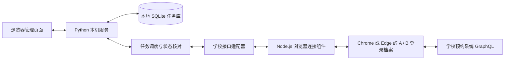

# 我的占座 · 运行原理与方案

适用版本：v0.5.1。程序在 Windows 本机运行，通过学校已登录的浏览器会话查询和管理预约。日常预约、退座与轮换均由固定程序逻辑完成，不调用 AI 模型、不需要 AI API Key。

## 组成

| 部分 | 作用 | 主要文件 |
| --- | --- | --- |
| 桌面入口 | 隐藏终端启动后台，已有服务正常时直接打开网页 | `启动我的占座.pyw` |
| 本机网页服务 | 仅监听 `127.0.0.1:5003`，提供页面和操作接口 | `server.py` |
| 任务引擎 | 预约状态、时间安排、接棒、冷却、失败恢复与保存 | `seat_core.py` |
| 学校接口适配 | 查询馆室和预约、发送预约或退座、核对结果 | `live_provider.py` |
| 浏览器连接 | 通过本机浏览器调试协议，在学校页面内发送请求 | `browser_worker.js`、`browser_headers.js` |
| 座位图 | 筛选江浦校区，规范化学校坐标和空闲状态 | `seat_layout.py`、`static/app.js` |

## 登录与保存

A、B 各使用独立的 Chrome／Edge 登录档案，保存在 `%LOCALAPPDATA%\MyNjtechSeat\BrowserProfiles`。登录由用户在学校官网完成；普通启动尝试恢复原会话，登录过期时需重新认证。只有主动点击“更换绑定账号”才建立新的角色档案。

程序不保存密码；浏览器自身在本机保留 Cookie。账号绑定记录包含加盐身份指纹和尾号标签，用来阻止误用其他身份；学校请求头和校验信息只在连接内存中使用。本机任务、时间、冷却、事件及待确认操作存入项目 `data/tasks.sqlite3`。

GitHub 仓库只交付源码、资源和说明，不包含上述登录档案、绑定信息、任务库或调试记录。新电脑下载代码后，需要自行建立自己的两个账号登录。

## 学校接口与座位图

接口路径为 `/index.php/graphql/`，从学校选座页面获取，也可经过学校图书馆 WebVPN。请求沿用已登录页面的会话；程序没有使用旧版闭源 EXE。

| 学校操作 | 用途 |
| --- | --- |
| `reserve`、`getSToken` | 查询实际预约，获取本次退座需要的校验信息 |
| `libs`、`libGroups`、`libLayout` | 读取馆室、校区分类、座位状态和坐标 |
| `reserueSeat` | 预约指定馆室和座位，保留学校接口的拼写 |
| `reserveCancle` | 退座，保留学校接口的拼写 |

界面使用学校提供的坐标，不补画未提供的门窗。不可选座位为红色，空闲为白色，用户双击选中的座位为绿色。编辑器每 20 秒刷新，保存时再次检查可选状态；最终是否预约成功以学校查询结果为准。

## 预约与接棒

1. 保存任务产生草稿；用户点击“开始”后，后台核对时间、两个账号登录、已有预约和冷却。
2. 空闲且保护等待已结束的账号先预约目标座位，程序再次查询，确认成功才记为持座。
3. 默认提前 300 秒准备接棒，可在任务中调整；同时满足接棒方冷却及当前方最短持座保护，才执行交接。
4. 当前账号退座后先确认释放，再立即让另一账号预约同一位置；中间不额外等待退座账号的冷却。
5. 再次查询学校结果，确认接棒方实际持座后记录切换；下一轮方向反转。

65 秒是程序当前设置的保护等待值，不能据此认为学校明确要求所有场景均等待 65 秒。两个账号交接由独立请求完成，存在网络延迟或被他人先选走的可能，无法保证原子切换。

## 控制与异常处理

- **暂停**：停止自动接棒，保留现有预约。
- **切换至账号 A／B**：核对保护和预约后手动接棒；原任务暂停时，切换完成后仍暂停。
- **结束轮换**：先保存停止意图，只释放确认匹配该任务馆室和座位的预约；确认结果后显示已结束，其他预约不退。
- **计划结束或退出后台**：停止执行，保留现有预约。
- **网络超时、登录失效、结果不明**：先核对实际结果；无法确认时进入待处理状态，不盲目重复退座或预约。
- **重启**：读取保存的操作意图，先检查实际预约再决定后续动作。
- **旧暂停记录阻塞新任务**：只有没有待确认操作、重新查询确认两账号登录有效且均无预约时，才结束旧空闲记录并继续启动新任务。其他冲突会显示并定位具体任务。

## 验证范围

当前通过 72 项不访问真实账号的 Python 测试、1 项 Node 本地 HTTP 请求头回归，以及隔离模拟库的网页流程检查。已完成受控的实际预约、退座和 A→B→A 两次接棒；完整的长期自动调度与现场异常恢复仍待验证。

登录验证码识别尚未成为程序内置功能。首次登录、会话过期或学校额外要求验证码时，仍需在学校页面处理。电脑关机、休眠、断网或后台退出时不能执行轮换；关闭管理网页本身不会停止后台。
